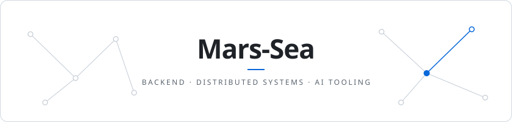

<!-- 图片均有浅色 / 深色两份，<picture> 按访客的 GitHub 主题切换；源文件在 assets/ -->

<picture>
  <source media="(prefers-color-scheme: dark)" srcset="assets/banner-dark.svg">
  
</picture>

Backend engineer working on Go / Java distributed systems and AI application tooling. 
I like turning messy problems into systems that are clear, maintainable and observable.

<picture>
  <source media="(prefers-color-scheme: dark)" srcset="assets/divider-dark.svg">
  
</picture>

### Currently

**Building** plugins and companion apps for [DeepSeek Harness](https://github.com/Mars-Sea/dsh-commandcode-provider) 
**Self-hosting** translation, routing and containers on my home network 
**Tinkering** with small hardware projects on ESP8266

<picture>
  <source media="(prefers-color-scheme: dark)" srcset="assets/divider-dark.svg">
  
</picture>

### Stack

  <picture>
    <source media="(prefers-color-scheme: dark)" srcset="assets/stack-dark.svg">
    
  </picture>

<picture>
  <source media="(prefers-color-scheme: dark)" srcset="assets/divider-dark.svg">
  
</picture>

[mars-sea.github.io](https://mars-sea.github.io/) · Issues and PRs are always welcome

